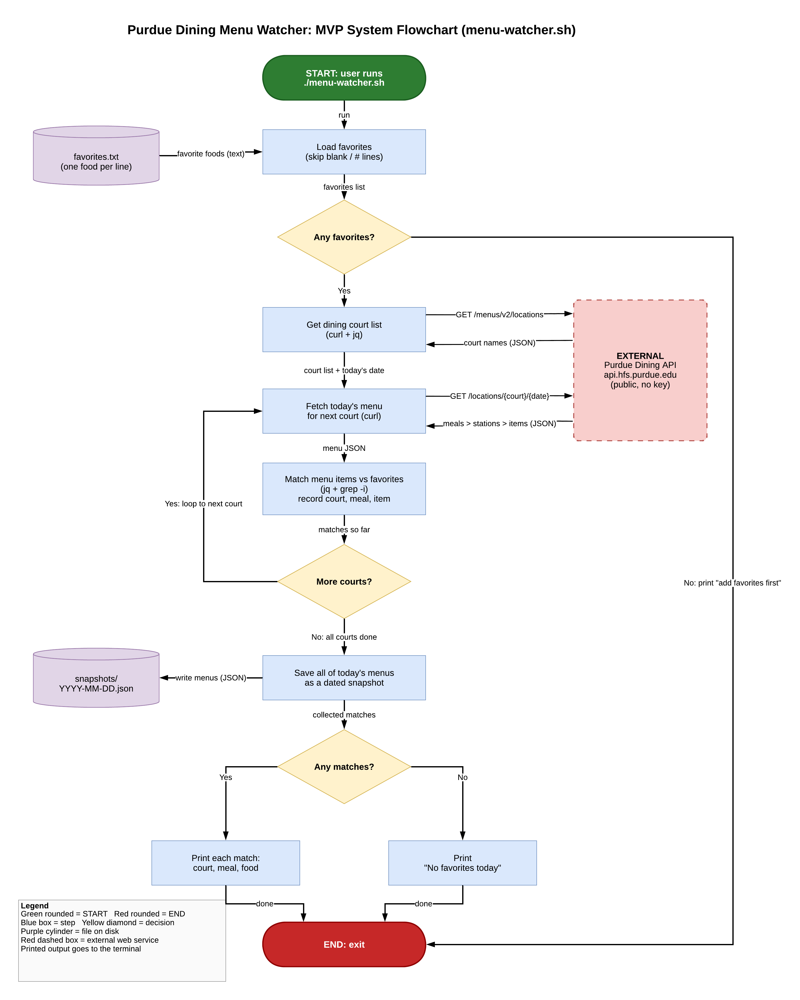

# Purdue Dining Menu Watcher: Design Doc

## Overview
`menu-watcher.sh` is a Bash script (curl, jq, grep) that checks every Purdue dining court's menu for today, matches the items against the foods listed in `favorites.txt`, prints the court and meal for each match, and saves a dated JSON snapshot of the day's menus in `snapshots/`.

## System diagram
Flowchart built in Lucidchart. The program starts at the green **START** node, and every arrow is labeled with the data or control it carries.

- Image: [`docs/system-diagram.png`](system-diagram.png), exported from Lucidchart
- Source file: [`docs/system-diagram.drawio`](system-diagram.drawio), which opens in Lucidchart (Import > draw.io) or draw.io

## Components
| Component | Role |
|---|---|
| `menu-watcher.sh` | Entry point; runs the whole pipeline |
| `favorites.txt` | Input: one favorite food per line (blank and `#` lines skipped) |
| Purdue Dining API (`api.hfs.purdue.edu/menus/v2`) | External data: list of courts, then each court's meals > stations > items for a date |
| Matcher (jq + `grep -i`) | Compares menu items to favorites and records court, meal, and item |
| `snapshots/YYYY-MM-DD.json` | Output: the day's full menus |
| Terminal output | Each match as court, meal, food, or "No favorites today" |

## Flow
1. Load favorites. If there are none, print "add favorites first" and exit.
2. Request the list of dining courts from the API.
3. For each court, fetch today's menu and match its items against favorites (loop until all courts are done).
4. Save all of today's menus as a dated snapshot.
5. Print every match, or "No favorites today", then exit.
